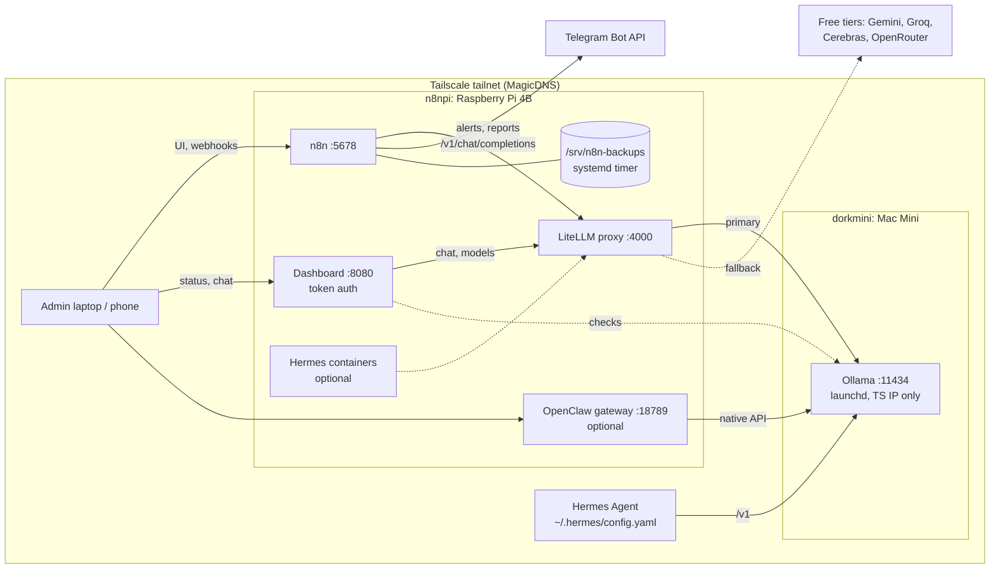
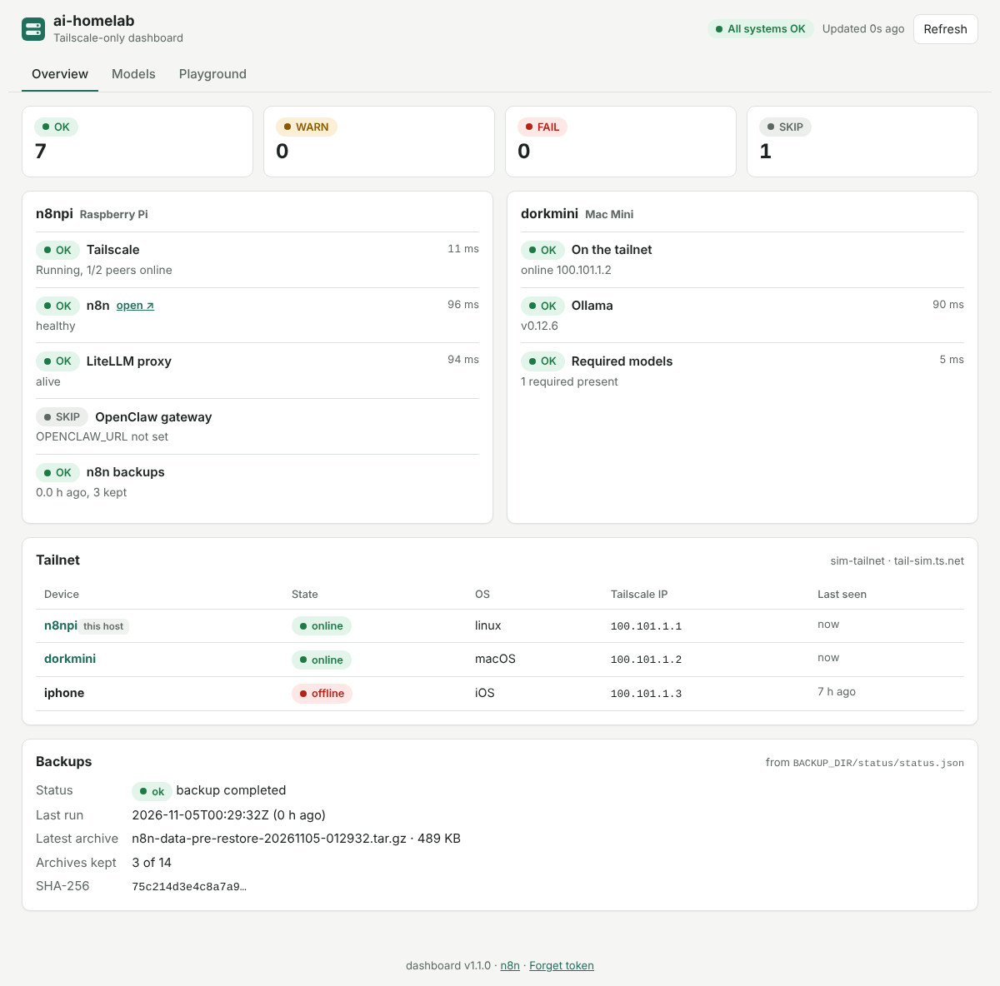

# ai-homelab

Infrastructure-as-code for a two-device, Tailscale-only AI homelab:
**n8npi** (Raspberry Pi 4B, always on, isolation box running n8n, LiteLLM and a
dashboard) and **dorkmini** (Mac Mini running Ollama and the larger models).
Nothing is publicly exposed: every service binds to a Tailscale IP. All secrets
and IPs live in `.env` (git-ignored); `make install` generates them.



**Traffic**: n8n and the dashboard call LiteLLM over the compose network; LiteLLM
prefers Ollama on dorkmini and falls back to free cloud tiers when the Mac is down
or rate-limited. Containers reach `dorkmini`/`n8npi` through fixed host entries
built from `.env`, so they do not depend on MagicDNS inside Docker. The only
internet egress is the LLM fallbacks, Telegram and image pulls.
Details: [docs/architecture.md](docs/architecture.md).

## Deploy

### Prerequisites

| Device | Needs |
|---|---|
| n8npi | Raspberry Pi OS 64-bit (or any arm64 Linux), Docker + compose plugin (`curl -fsSL https://get.docker.com \| sh`), Tailscale logged in, `git`, `make`, `python3`; your user in the `docker` group |
| dorkmini | Tailscale app, `brew install ollama` |
| Both | Same tailnet, MagicDNS on, device names `n8npi` and `dorkmini` in the admin console |

### 1. dorkmini (Mac)

```bash
git clone https://github.com/ScanedDork/ai-homelab.git && cd ai-homelab
./mac/install-ollama-launchd.sh     # Ollama on the Tailscale IP only (quit Ollama.app first)
./mac/pull-models.sh                # expected models; idempotent
./scripts/preflight.sh              # Mac checks: binding, LaunchAgent, sleep, models
```

### 2. n8npi (Pi)

```bash
sudo git clone https://github.com/ScanedDork/ai-homelab.git /opt/ai-homelab
sudo chown -R "$USER": /opt/ai-homelab && cd /opt/ai-homelab
make install      # .env from Tailscale + generated secrets, backup dir, systemd units
$EDITOR .env      # optional: TELEGRAM_BOT_TOKEN, TELEGRAM_CHAT_ID, cloud API keys
make up-pi        # preflight, then n8n + LiteLLM + dashboard
make provision    # n8n credentials + 3 workflows, activated, webhook round-trip verified
make health
```

`make install` never overwrites values you set. On a Pi that already runs n8n it
adopts the existing encryption key from the volume (set `N8N_VOLUME_NAME` first and
stop the old container), so saved credentials stay readable.

### 3. Verify

- Dashboard: `http://n8npi:8080/` and paste `DASHBOARD_TOKEN` from `.env`.
  Everything green means it works.
- n8n: `http://n8npi:5678/` and create the owner account on first visit.
- Playground tab: send a prompt; the reply says `via local-chat` (served by dorkmini)
  or `via <cloud group> · 1 fallback`.

Then apply the Tailscale ACL ([docs/tailscale.md](docs/tailscale.md)), work through
[docs/security.md](docs/security.md), and save `.env` in your password manager.



## Repo layout

| Path | What |
|---|---|
| `pi/docker-compose.yml` | n8n, LiteLLM and dashboard (arm64, healthchecks, restart policies, Tailscale-IP binds, fixed tailnet host entries) + commented, scalable Hermes block |
| `dashboard/` | Web dashboard: status by device, tailnet devices, models, LiteLLM playground (stdlib Python + vanilla JS, tests) |
| `mac/` | Ollama LaunchAgent template + installer (`OLLAMA_HOST` on the Tailscale IP), model pull script, notes |
| `litellm/` | Proxy config: local first, free-tier fallbacks, rate-limit settings |
| `hermes/` | `config.yaml.template` (dorkmini base URL, `qwen3.5:4b`) + model switching and multi-container notes |
| `openclaw/` | Gateway compose (official multi-arch image, Tailscale-IP bind, token auth) + headless onboarding |
| `scripts/` | `install-pi.sh`, `preflight.sh`, `provision-n8n.sh`, `healthcheck.sh`, `backup-n8n.sh`, `restore-n8n.sh`, `update.sh`, `dashboard-dev.sh`, validators, tests, `systemd/` + `cron/` samples |
| `n8n-workflows/` | Daily healthcheck → Telegram, prompt webhook → LiteLLM, weekly backup report |
| `docs/` | Architecture, Tailscale (ACLs), security checklist, runbook, models, storage migration plan |
| `Makefile` | `make help` lists every target |
| `.github/workflows/validate.yml` | CI: lint, validate, tests (dashboard + installer), dashboard image build |

Every script supports `--help`.

## Day-2 operations

```bash
make health             # OK/FAIL table (the dashboard shows the same, live)
make update             # pull n8n + LiteLLM, roll back automatically if unhealthy
make backup             # backup now (nightly via systemd timer, rotated)
./scripts/restore-n8n.sh --latest
make logs               # follow the Pi stack's logs
make provision          # re-run after changing tokens or workflows (idempotent)
make lint validate test # what CI runs
```

Troubleshooting: [docs/runbook.md](docs/runbook.md).

## What is not automated

- Installing Docker, Tailscale and Ollama; `tailscale up`; applying the ACLs.
- Creating the Telegram bot and finding the chat ID (runbook explains how).
- n8n's owner account (created in the browser on first visit).
- Copying backups off the Pi, and backing up `.env` (it holds the encryption key).
- OpenClaw onboarding and enabling the commented Hermes containers (both documented).
- Mac power settings, FileVault/auto-login choice, removing the Ollama.app login item.
- The website migration in `docs/storage-migration.md` (plan only).

## How this was tested

No real devices were available to the build environment. The full flow above
(`make install`, `up-pi`, `provision`, `health`, `backup`, restore, `update`) was run
on a Linux VM simulating the tailnet:

- two 100.x addresses on a `tailscale0` interface, a fake `tailscale` CLI and tailscaled socket
- the real n8n and LiteLLM images, and the dashboard image built from this repo
- an Ollama stub on the "dorkmini" address

Covered: webhook → n8n → LiteLLM → Ollama round trips, dashboard checks and chat,
and dorkmini going offline. What remains device-specific is listed under
"Assumptions to verify" in the PR.
