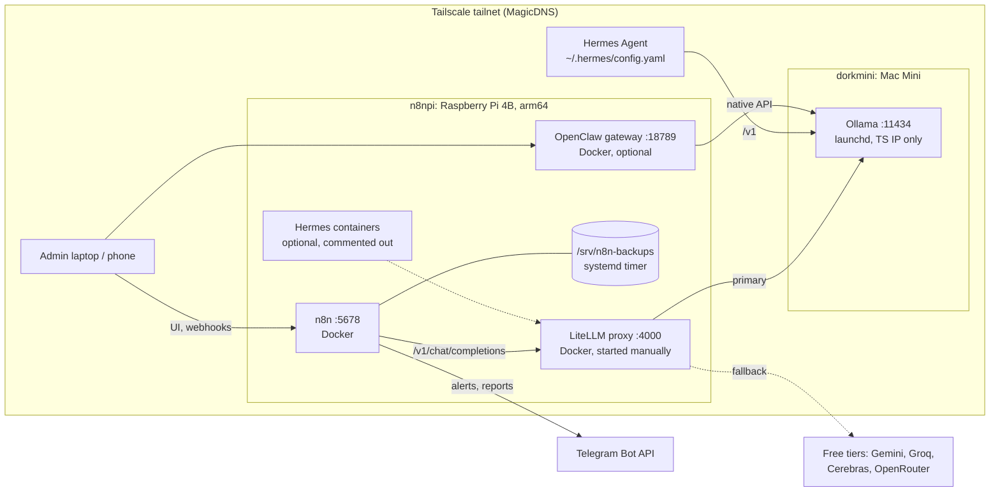

# ai-homelab

Infrastructure-as-code for a two-device, Tailscale-only AI homelab:
**n8npi** (Raspberry Pi 4B, always on, isolation box running n8n) and **dorkmini**
(Mac Mini running Ollama and the larger models). Nothing is publicly exposed;
every service binds to a Tailscale IP. All secrets and IPs live in `.env` (git-ignored).



**Traffic**: clients reach n8n over the tailnet; n8n calls LiteLLM, which prefers
Ollama on dorkmini and falls back to free cloud tiers when the Mac is down or
rate-limited. Hermes calls Ollama directly. The only internet egress is the LLM
fallbacks, Telegram, and image pulls. Details: [docs/architecture.md](docs/architecture.md).

## Repo layout

| Path | What |
|---|---|
| `pi/docker-compose.yml` | n8n (arm64, healthcheck, restart policy, named volume, Europe/Prague, Tailscale-IP bind) + commented, scalable Hermes block |
| `mac/` | Ollama LaunchAgent template, installer that binds `OLLAMA_HOST` to the Tailscale IP, model pull script, notes |
| `litellm/` | Proxy config (local first, free-tier fallbacks, rate-limit settings) + run/usage notes |
| `hermes/` | `config.yaml.template` (dorkmini base URL, `qwen3.5:4b`) + model-switching notes |
| `openclaw/` | Gateway compose (official multi-arch image, Tailscale-IP bind, token auth) + headless onboarding |
| `scripts/` | `healthcheck.sh`, `backup-n8n.sh`, `restore-n8n.sh`, `update.sh`, validators, `systemd/` timer + Docker drop-in, `cron/` sample |
| `n8n-workflows/` | Importable: daily healthcheck → Telegram, prompt webhook → LiteLLM, weekly backup report |
| `docs/` | architecture, tailscale (ACLs), security checklist, runbook, models, storage migration plan |
| `Makefile` | `lint`, `validate`, `up-pi`, `down-pi`, `backup`, `health` |
| `.github/workflows/validate.yml` | CI: yamllint, shellcheck, `docker compose config`, JSON/plist validation, secret scan |

Every script supports `--help`.

## Quick start

On **n8npi** (repo at `/opt/ai-homelab`):

```bash
cp .env.example .env && chmod 600 .env   # fill in PI_TAILSCALE_IP, N8N_ENCRYPTION_KEY, ...
sudo install -d -o "$USER" -g "$USER" /srv/n8n-backups/status
make validate
make up-pi
make health
```

On **dorkmini**:

```bash
./mac/install-ollama-launchd.sh
./mac/pull-models.sh
```

Then follow the first-deployment checklist below.

## First deployment checklist

1. **Existing n8n?** Back up its volume first. Set `N8N_VOLUME_NAME` to the existing
   volume and copy its key from `/home/node/.n8n/config` into `N8N_ENCRYPTION_KEY`.
   Stop the old container (`docker stop <old>`) so port 5678 and the name `n8n` are free.
2. Fill `.env`: `PI_TAILSCALE_IP`, `MAC_TAILSCALE_IP` (`tailscale ip -4` on each),
   the encryption key, LiteLLM master key and any provider keys.
3. Pi: install `scripts/systemd/docker-wait-for-tailscale.conf`, then `make up-pi`;
   open `http://n8npi:5678`.
4. Mac: quit Ollama.app and remove its login item, run the two `mac/` scripts, and
   check `lsof -nP -iTCP:11434 -sTCP:LISTEN` shows only the 100.x address.
5. Pi: start LiteLLM (`litellm/README.md`); `make health` should be all OK.
6. n8n: create credentials (Telegram bot, two Header Auth), import the three
   workflows, edit each **Config** node (Telegram chat ID), then activate (publish) them.
7. Enable the backup timer (`scripts/systemd/n8n-backup@.service` header), run
   `make backup` once, and test `./scripts/restore-n8n.sh --latest`.
8. Optional: OpenClaw (`openclaw/README.md` "First run"), then set `OPENCLAW_URL`
   so `make health` checks it. Optional: Hermes containers (`hermes/README.md`).
9. Apply the Tailscale ACL from `docs/tailscale.md`; work through `docs/security.md`.
10. Save `.env` to your password manager.

## What is not automated

- Installing Docker, Tailscale, Ollama; `tailscale up`; applying the ACLs (`docs/tailscale.md`).
- Starting LiteLLM (a documented `docker run`, not in compose).
- Installing the systemd timer/drop-in or crontab on the Pi.
- Creating n8n credentials (Telegram, header auth) and editing workflow Config nodes.
- Copying backups off the Pi, and backing up `.env` (holds the encryption key).
- Running OpenClaw onboarding and enabling the commented Hermes containers (both documented).
- Mac power settings, FileVault/auto-login choice, Ollama.app login item.
- The website migration in `docs/storage-migration.md` (plan only).
- Nothing here has been run against the real devices; CI validates statically.

## Common commands

```bash
make lint validate      # what CI runs
make health             # OK/FAIL table
make backup             # backup now (rotates to BACKUP_RETENTION)
./scripts/update.sh     # pull + restart n8n, rollback if unhealthy
./scripts/restore-n8n.sh --latest
```
