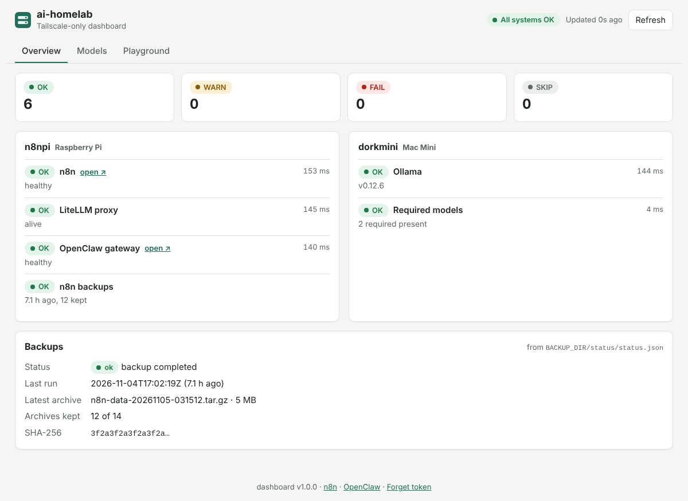
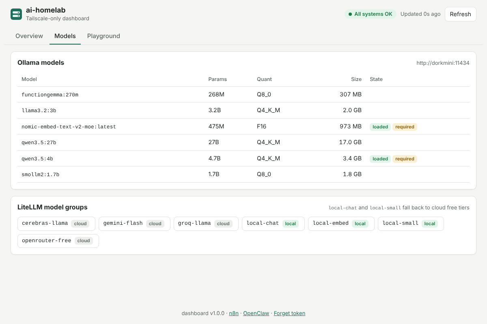
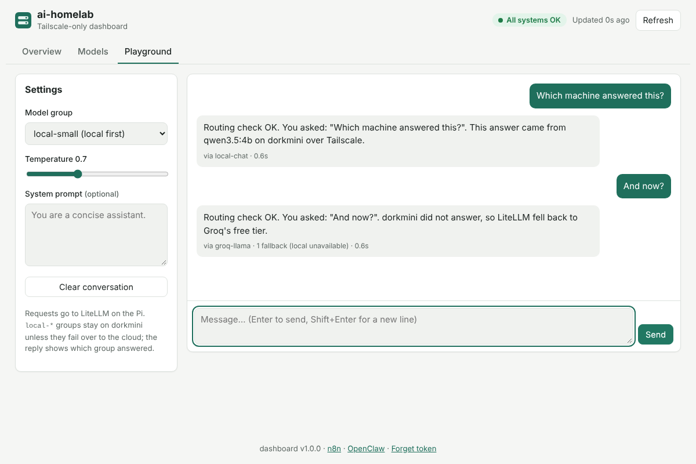

# Homelab dashboard

A small web UI for the homelab, served on **n8npi** next to n8n:

- **Overview**: n8n, LiteLLM, OpenClaw and backups on n8npi, plus Ollama and the
  required models on dorkmini. These are the same checks as `scripts/healthcheck.sh`,
  refreshed every 30 s.
- **Models**: installed Ollama models (params, quantisation, size), which are loaded
  and which are required, plus the LiteLLM model groups.
- **Playground**: chat through LiteLLM with streamed replies. Each reply shows which
  group actually answered and whether LiteLLM fell back, e.g.
  `via groq-llama · 1 fallback`. It's a quick way to see that routing works.



| Models | Playground |
|---|---|
|  |  |

## Design

```
browser ──(Tailscale, Bearer DASHBOARD_TOKEN)──▶ dashboard :8080 on n8npi
                                                   ├─▶ n8n        http://n8n:5678 (compose network)
                                                   ├─▶ LiteLLM    LITELLM_URL  (key stays server-side)
                                                   ├─▶ Ollama     OLLAMA_URL
                                                   ├─▶ OpenClaw   OPENCLAW_URL (optional)
                                                   └─▶ status.json (read-only bind mount)
```

- `server.py` uses only the Python standard library, so there are no pip dependencies
  to audit or update. The page in `static/` is plain HTML/CSS/JS with no build step
  and no CDN, which keeps the CSP at `default-src 'self'`. Upstream data is rendered
  with `textContent` only.
- The browser never calls Ollama or LiteLLM directly and never sees
  `LITELLM_MASTER_KEY`.
- Every `/api/*` route needs `Authorization: Bearer $DASHBOARD_TOKEN`. The page asks
  for the token once and keeps it in that browser's localStorage ("Forget token"
  clears it). Only `/healthz` and the static files are public. The server refuses to
  start with an empty, short or placeholder token.
- The container runs as uid 10001 with a read-only filesystem and all Linux
  capabilities dropped, plus `no-new-privileges` and a 128 MB memory limit. It is
  published only on `PI_TAILSCALE_IP`.
- Chat input is validated before it reaches LiteLLM: model-group name pattern, at
  most 50 messages and 32k characters, valid roles, and temperature 0–2.

## Run

On the Pi it's part of the stack: `make up-pi` builds and starts it. Open
`http://n8npi:8080/` (`DASHBOARD_PORT`).

Elsewhere, without Docker (for example to try it from a laptop on the tailnet):

```bash
make dashboard-dev          # serves 127.0.0.1:8080 using .env
```

## Configuration (`.env`)

| Variable | Default | Purpose |
|---|---|---|
| `DASHBOARD_TOKEN` | *(required)* | API token, `openssl rand -hex 32` |
| `DASHBOARD_PORT` | `8080` | Host port on the Pi's Tailscale IP |
| `DASHBOARD_URL` | `http://n8npi:8080` | Used by `scripts/healthcheck.sh` |
| `BACKUP_MAX_AGE_HOURS` | `36` | Backups older than this show WARN |
| `N8N_URL`, `OLLAMA_URL`, `LITELLM_URL`, `OPENCLAW_URL`, `LITELLM_MASTER_KEY`, `HEALTHCHECK_REQUIRED_MODELS` | shared | Same values the scripts use |

Advanced, set in compose if needed: `DASHBOARD_REFRESH_SECONDS` (30),
`DASHBOARD_CHECK_TIMEOUT` (5 s), `DASHBOARD_CHAT_TIMEOUT` (180 s),
`DASHBOARD_CACHE_SECONDS` (5), `DASHBOARD_ACCESS_LOG` (`0` to silence).

## API

| Route | Auth | Returns |
|---|---|---|
| `GET /healthz` | no | `{"status":"ok"}` |
| `GET /api/config` | yes | links, refresh interval, version (no secrets) |
| `GET /api/status` | yes | checks with `status` OK/WARN/FAIL/SKIP, `device`, `detail`, `latency_ms` |
| `GET /api/models` | yes | Ollama installed/loaded/missing-required, LiteLLM groups |
| `GET /api/backups` | yes | `status.json` plus `age_hours` and `stale` |
| `POST /api/chat` | yes | OpenAI-style body; SSE stream; `X-Model-Group` and `X-Attempted-Fallbacks` headers |

## Tests

`make test` runs `tests/test_server.py`: 17 tests against stub upstreams, covering
auth, status grouping, stale or failed backups, models, chat streaming, routing
headers, input validation, security headers, path traversal and token validation.
CI also builds the image.
